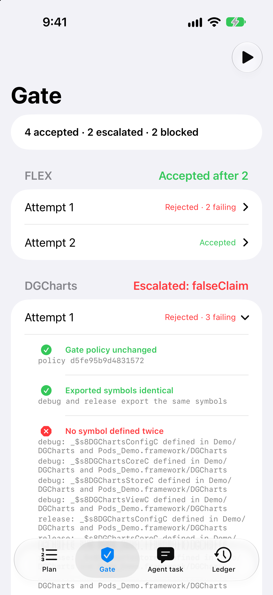
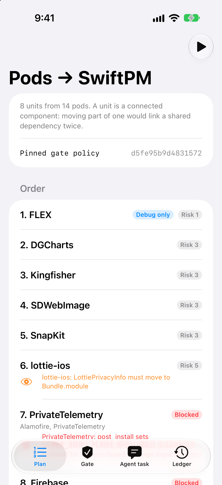
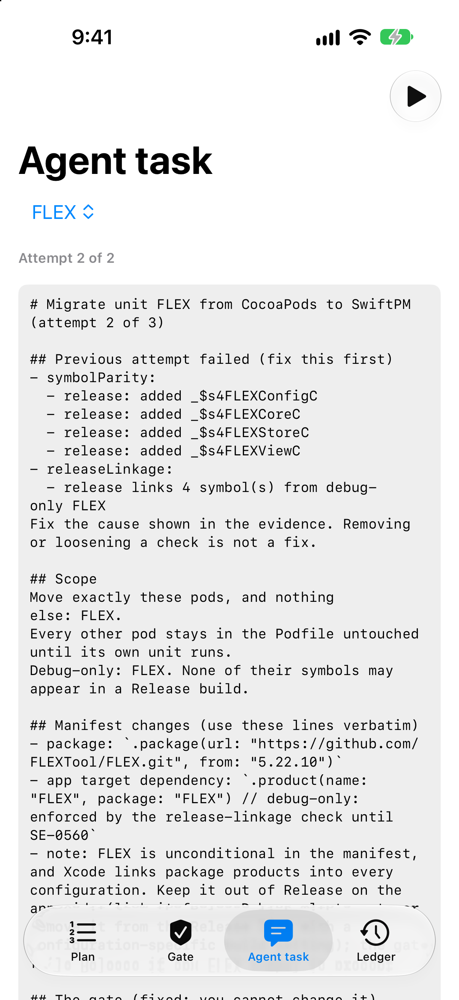
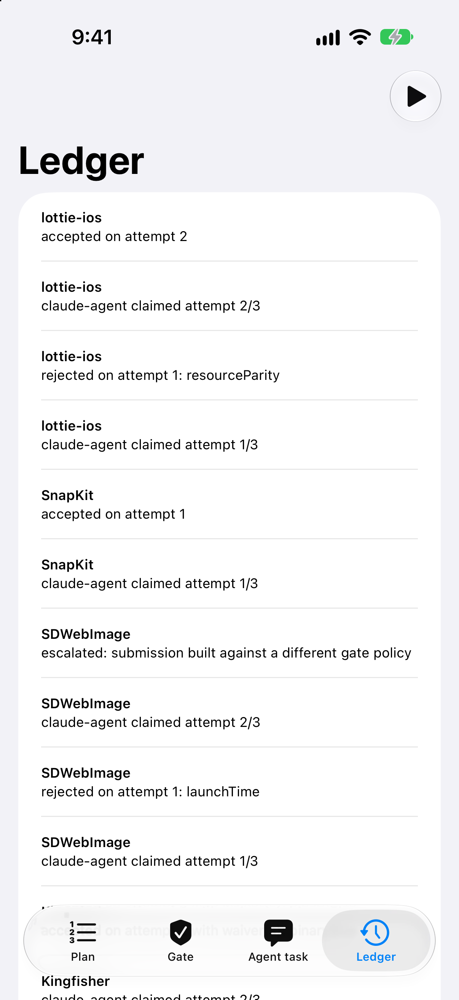

# MigrationGate Demo

**Watch a scripted coding agent migrate a 15-pod iOS app from CocoaPods to SwiftPM, and watch the gate catch
it every time it gets something wrong.**

This SwiftUI app runs the library's reference migration end to end: the planner orders the units, the
coordinator hands each one to a scripted agent under a lease, and the real `EquivalenceGate` judges every
attempt. The library lives in its own repo, **[spm-migration-gate-kit](https://github.com/rajatslakhina/spm-migration-gate-kit)**,
and this project consumes it as a remote Swift package pinned to its release (`upToNextMajorVersion` from
`1.0.0`), the same way a product team would.

  
  
  
  

*Captured from the demo running on an iPhone 18 Pro Simulator (iOS 27.2); see Verification for exactly how.*

## Why this matters

CocoaPods trunk goes read-only on 2 December 2026. An agent can do the per-pod work, but only if "done" is
measured by something it cannot argue with or edit. The demo shows what that looks like in practice: of six
units handed to the agent, four are accepted (two after a repair, one with a human waiver) and two are
escalated to a human: one for reporting failing checks as passing, one for loosening the gate's own policy.
Two more units never reach the agent, because their blockers need a decision a model should not make.

## What you'll see

| Unit | What the scripted agent does | What the gate does |
| --- | --- | --- |
| FLEX (debug-only) | Attempt 1 links FLEX into Release. | Rejects it (`releaseLinkage`, `symbolParity`); attempt 2 is accepted. |
| DGCharts | Adds the package but leaves the pod, and reports every check as passing. | Finds a duplicate definition and a module linked from both Pods and SwiftPM, then escalates for the false claim. |
| Kingfisher | The package build is 180,000 bytes larger. | Rejects on `binarySize`; a named lead records a waiver with an expiry; attempt 2 is accepted with the waiver shown. |
| SDWebImage | Slows the cold-launch tail; on attempt 2, raises the p90 budget in its own branch. | Rejects on `launchTime` (p90), then marks attempt 2 `tampered` and escalates. |
| SnapKit | Clean migration. | Accepted on attempt 1. |
| lottie-ios | Forgets to declare the resources. | Rejects on `resourceParity`; the next agent task quotes the missing files; attempt 2 is accepted. |
| PrivateTelemetry + Alamofire | — | Blocked in the plan: a `post_install` flag needs `unsafeFlags`, which SwiftPM refuses for version-based package dependencies. Alamofire waits because PrivateTelemetry depends on it. |
| Firebase (6 pods) | — | Blocked in the plan: the `nanopb` pod is 3.x, its Swift package 2.x. A human decides whether that is a rename or an upgrade. |

The four tabs:

- **Plan**: units in order, risk, blockers and review warnings, the pinned policy fingerprint, and build tools
  set aside for a plugin track.
- **Gate**: every attempt and its eleven checks with the gate's own evidence lines. Escalated units open with
  their final report expanded.
- **Agent task**: the exact prompt each attempt received, newest first, including the previous failure's
  evidence.
- **Ledger**: claims, verdicts, waivers and escalations in order.

The app owns the gate policy (`DemoConfiguration.gatePolicy` in `Demo/DemoApp.swift`) and passes it to the
library's dashboard, the way a team would pin tolerances when the migration starts.

## How to run it

1. `git clone https://github.com/rajatslakhina/spm-migration-gate-demo-app.git`
2. Open `Demo.xcodeproj` in Xcode 16 or later. Xcode resolves `spm-migration-gate-kit` from GitHub.
3. Select the **Demo** scheme and any iPhone Simulator.
4. Build & Run, then tap **▶ Run migration** (top right). The Gate tab fills in.

Launch arguments `-tab gate`, `-tab prompt` or `-tab ledger` open that tab and run the migration on launch.

## Design notes

- **The library owns all logic; the app owns configuration.** The dashboard view and its model live in the
  kit's `MigrationGateUI` product. The scripted run itself is covered by the kit's tests:
  `ReferenceMigrationTests` asserts each unit's final state and the failing checks of every rejected attempt in
  the table above (the SwiftUI view layer has no unit tests).
- **Scripted, not live.** The agent and its build evidence are synthetic and deterministic, so the demo shows
  the same thing on every run and in CI. The gate, planner, coordinator and prompt builder are the real code.
- **A run is generation-guarded.** Re-running while a run is in flight never lets an older result overwrite
  a newer one.

## Verification

Stated exactly, because "it builds" and "it ran" are different claims:

- **Built**: `xcodebuild` for `generic/platform=iOS Simulator` (Xcode 27.2), with no compiler warnings.
  Before the kit was published, this build went through a scratch workspace that substituted the local
  kit checkout for the remote package; the project file itself always references the GitHub URL.
- **Ran on a Simulator**: the app was installed with `simctl` on a dedicated iPhone 18 Pro Simulator
  (iOS 27.2) and launched four times, with `-tab plan`, `-tab gate`, `-tab prompt` and `-tab ledger`. Each
  process was confirmed still running about 10 seconds after launch, and the four screenshots above were
  captured from those launches of the final build.
- **Not exercised**: no taps were performed. The screenshots come from launch-argument auto-runs, so the
  toolbar **Run migration** tap from the Plan tab (How to run, step 4) has been checked by reading the code
  (it calls `run()` and switches to the Gate tab), not by tapping it.
- **Library**: 73 tests on macOS and Linux and a 31-mutant check, in the
  [kit repo](https://github.com/rajatslakhina/spm-migration-gate-kit).
- **GitHub Actions**: the [Actions tab](../../actions) resolves the kit from GitHub at the pinned version
  and builds the app for a generic iOS Simulator on every push.

## License

MIT
